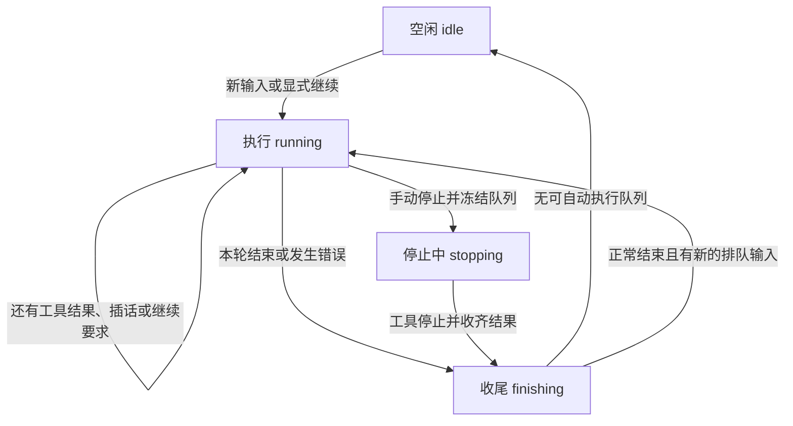

# 会话状态与停止契约

本文适用于 harness 与 Claude 线程，规定状态归属、停止、消息交接，以及执行被打断后怎么接着做。

## 状态的归属

「会话」指持久的 Thread；执行进程关闭不删除会话或历史。本文中的执行字段采用显示协议含义，内部运行类型由代码定义。

| 层次 | 字段 | 含义 |
| --- | --- | --- |
| 工作区生命周期 | `preparing / open / failed / archived / transferred` | 目录是否可用；这里的 failed 是工作区准备失败，transferred 是执行权已流转到别的工作机、本地记录冻结 |
| agent 持久生命周期 | `open / archived` | 实例是否归档 |
| 执行阶段 | `phase`：`idle / running / stopping / finishing` | 当前本地执行到了哪里 |
| 执行占用 | `busy` | 本地仍有模型、工具或收尾在执行 |
| 上一回合结果 | `lastOutcome`：`completed / interrupted / failed` | 上一回合如何结束；新回合开始时清除旧结果 |
| 等待继续 | `waitingForResume` | 禁止自动消费队列，可由新输入或 resume 显式推进；崩溃循环停下的只认用户本人的消息、回应和 resume，见 [被打断之后](#被打断之后) |
| 等你批准 | `waiting?: {id, kind, since, ...}` | 回合卡在一项审批上等人批准，执行阶段仍为 running 且 busy；决定作为那次工具调用的结果交回模型，停止视为拒绝，见 [工具审批与提问](工具审批与提问.md) |
| 没回应的请求 | `asks?: [{id, kind, since, ...}]` | 代理发出的提问与密钥请求，不阻塞回合、不影响执行阶段；回应后结果作为一条输入交给代理，见 [工具审批与提问](工具审批与提问.md) |
| 上下文压缩 | `compacting` | 正在生成压缩摘要，是 running 的子状态：回合之间的压缩（手动压缩、Claude 回合后的自动压缩与空闲压缩）期间也是 running 且 busy，但不算回合，结束回到空闲不记回合收尾；停止会取消本次压缩 |
| 工具结果 | `success / error / not_executed / unknown` | 单次调用的结果；错误和结果未知都交回模型处理，见 [被打断之后](#被打断之后) |
| 客户端状态 | 连接、投递和停止请求是否已确认 | 不改变服务端的执行阶段 |

历史和实时状态统一使用 [会话显示协议](会话显示协议.md)，客户端可用操作以服务端 capabilities 为准。

## 四个执行阶段

| 阶段 | 含义 |
| --- | --- |
| `idle` | 本地没有正在推进的回合；须结合结果和等待条件判断可做什么 |
| `running` | 回合正在推进，可能等待模型、工具或批次快照 |
| `stopping` | 已发出取消，等待模型与工具确认停止 |
| `finishing` | 正在收尾，尚不能开始下一回合 |

普通失败返回 `idle + failed + waitingForResume`，队列保留。手动停止把队列里停止方自己的消息退给它（用户停下时是人发的消息），正常结束为 `idle + interrupted`，队列里还留着别的输入时同时 `waitingForResume`；没有名为 paused 的阶段。普通失败与手动停止采用不同的队列规则。

等待继续时，用户、Line 或其他代理发来新消息即继续，用户也可以在 App 里点继续；代理没有单独的继续工具。崩溃循环停下的例外，见 [被打断之后](#被打断之后)。

## 被打断之后

**结果未知只是一个工具结果。** 工具执行被意外打断、做没做成不清楚时（kited 崩溃时它正在执行、执行中出了意料之外的错误、命令结束后进程组没停下；kited 正常关闭时由它主动打断的命令和手动停止一样记为出错，正文写明已经发生的改动未撤销），这次调用的结果记为 `unknown`，正文写明被打断、结果未知，照常交给模型，由它先检查实际状态再决定要不要重做。宿主不重放这次调用，也不另设需要人确认的状态。

**被 kited 退出打断的回合自动接着做，由 kited 决定。** kited 崩溃或关闭时（不是用户停下的）正在进行的回合，下次打开会话时：没结束的请求记为中断，开始了没结果的工具记为结果未知，没开始的记为未执行，回合记为被退出打断（`failed`）。打开会话本身不开始执行，被打断的回合和退出前收下、还没开始的输入都停在等待继续；kited 启动时打开这些会话，本机正在执行的工作区里的接着做，交接中或已流转走的留在等待继续，崩溃照样计数，被打断的标记留着，等人继续或下次启动时再看。接着做时先在队列前面放一条继续说明（「接着被打断的任务」），两种后端一样。强制接管时副本里被打断的回合同样接着做，继续说明里写明原工作机可能还在执行。会话登记的命令进程组不随 kited 退出，打开会话时先停掉，停不掉的写进继续说明；登记时记下启动时刻，停之前核对，组号已经给了别的进程的不停、从登记里去掉。

**已收到手动停止的按停止收尾。** 停止已经记下、回合还没收尾时 kited 退出的，下次打开会话时同样补齐请求和工具的结果，但回合结果是被停止（`interrupted`），不算被 kited 打断，不计入连续崩溃，也不接着做；队列按手动停止的规则留着等继续。

**连续崩溃停下等人。** 连续 3 次被崩溃打断时判断为崩溃循环，不再接着做，停在等待继续。计数只在回合正常完成、用户本人发来消息或回应、显式继续时清零；工具结果不算（接着做时模型先检查实际状态，检查本身总会成功），关闭时停下的也不算。这种等待只有用户本人的消息（包括 Line 照原文转达的）、用户的回应（回答提问、密钥请求的结果）或显式继续能解除；Kite 自动发的其他输入（monitor 事件、子代理回报、后台命令结束的通知等）和代理的来信照常排队，不起回合。

**停下等人的只有无法继续运行的情况，都是明确的失败。**

- 模型请求连不上、中途断开、服务端出错（5xx）、限流（429）时，按 2、4、8、16、32 秒退避重试，重试 5 次仍失败才让回合失败；登录失效、余额不足、请求本身不对（如超出窗口）直接失败。模型在回复中途报错时按错误码分：超出窗口、额度用完、订阅不含、提示词或图片本身不对的直接失败，其余重试；ChatGPT 的 429 是额度用完或订阅不含时同样直接失败，只有请求太快才重试。已开始的工具照常做完，收到了还没开始的不再执行、记为未执行，重发的请求带着这些结果。
- 会话记录写不进去（如磁盘满）时执行立即停下、回合失败；之后的发送或继续先从硬盘上的记录重新打开会话。
- 崩溃循环，见上。

只读历史发现未收尾回合时显示为等待继续，不为读历史唤醒模型或工具；打开会话也不开始执行，由 kited 按上面的规则决定接着做。被 kited 关闭停下的回合不算回合结束，不向发起方回报。

## 手动停止与消息交接

**手动停止结束整个会话的当前执行，尚未纳入请求的消息退给发起停止的一方。** 用户停下时，退回人发的消息给发起客户端、回到输入框。由代理（`agent_stop`）或 Line 发起的停止，只把停止方自己发来的消息退给它：停下别人的一方不再需要对方照这些话做，留着只会让对方一直等继续；还要对方做的，停下后再发，新消息让它继续。别人的话不退回：代理或 Line 停下时用户发的消息、别的代理的来信和 Kite 自动发的通知都留在队列里，用户看得到，随下一条输入或继续交给模型。已执行的文件操作不撤销，已纳入请求的消息保留历史。

`POST /threads/:id/interrupt` 接收 `{id, inputs?}`，返回 `{returned}`。id 是本次停止操作的标识；inputs 是发起客户端尚未得到确认的消息（id、text、source），工作机还没收到的照登记并一律退回，迟到的发送只去重。Line 经这个入口停止时带来源标头，按 Line 认停止方。

停止后不再自动推进，留在队列里的也等新输入或继续；仅退回尚未交给模型请求、属于停止方的输入，等执行与收尾停止后才确认完成。停止期间拒绝新发送和继续。发起客户端保留 returned 的顺序及已有草稿，并移除对应待处理输入；并发投递不能造成重复或丢失。

同一停止 id 重试返回同一收据，重开实例后也成立。被退回消息的迟到发送或重试只做去重，不重新执行；重新发送草稿使用新消息 id。响应丢失时，客户端保留原停止请求供重试，确认之前不放行新发送。其他设备只收到 pending 变化，不重复生成草稿。终端返回正文供用户重新编辑，不自动重发。

清理期间其他控制请求仍应得到明确响应。手动停止清除该线程待自动采纳的意图；若回合结果已确定而仍在收尾，停止仍退回队列并等待，但不追溯改变已确定的结果。

服务关闭执行实例时保留待处理输入，不产生手动停止的退回结果，也不改写客户端草稿。

Claude 使用同一显示状态和停止 API，输入是否纳入、是否撤回以其原生交接确认为准，不能仅凭本地队列判断。停止须等模型和受管命令退出；停止没完成就被 kited 退出打断时，下次打开会话补完这次停止的收据，用原请求重试取回草稿；结果是被停下，不接着做，也不计入连续崩溃，见 [被打断之后](#被打断之后)。

交给 Claude 还没收尾的输入按原生记录核对：进了原生记录的算交过，没进的重新排队，接着做时按原顺序先交。原生记录读不了时，起下一个进程前再核对，核对不了就停下等人。已有原生记录的输入不得重复投递，未完成工具不得自动重放。

## 状态表达原则

各端使用相同的状态含义，执行阶段、上一回合结果和等待继续分别表达，不能用其中一项推断另一项。思考与工具内容不增加执行子状态，语义见 [显示原则](会话显示协议.md#显示原则)。

上下文占比必须同时具有可靠的输入用量与窗口上限，缺少任一项即为未知，不能按模型名猜常量。测量所属请求、时间及更新语义见 [显示协议](会话显示协议.md#当前边界)。
