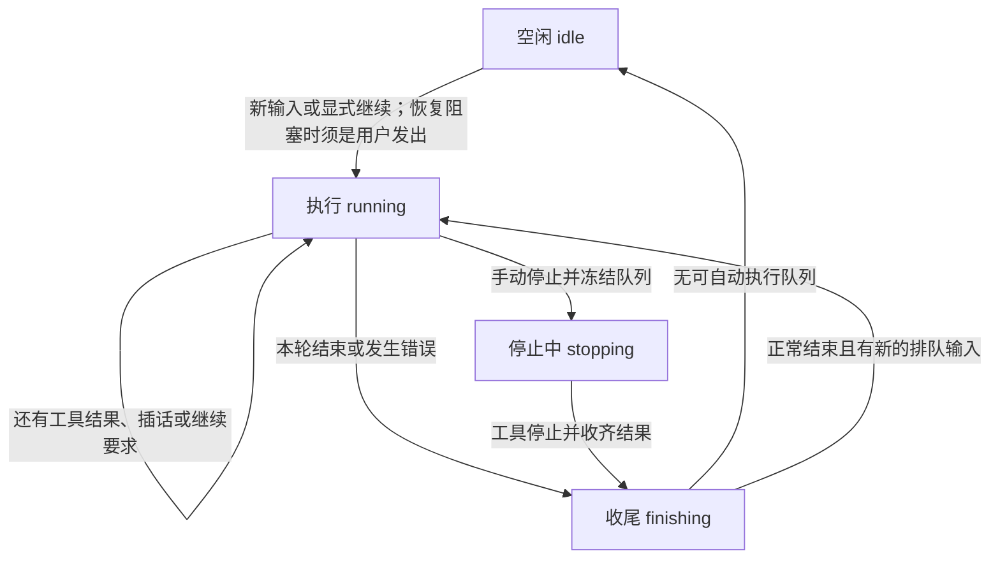

# 会话状态与停止契约

本文适用于 harness 与 Claude 线程，规定状态归属、停止、消息交接与恢复边界。

## 状态的归属

「会话」指持久的 Thread；执行进程关闭不删除会话或历史。本文中的执行字段采用显示协议含义，内部运行类型由代码定义。

| 层次 | 字段 | 含义 |
| --- | --- | --- |
| 工作区生命周期 | `preparing / open / failed / archived / transferred` | 目录是否可用；这里的 failed 是工作区准备失败，transferred 是执行权已流转到别的工作机、本地记录冻结 |
| agent 持久生命周期 | `open / archived` | 实例是否归档 |
| 执行阶段 | `phase`：`idle / running / stopping / finishing` | 当前本地执行到了哪里 |
| 执行占用 | `busy` | 本地仍有模型、工具或收尾在执行，不包含恢复阻塞 |
| 上一回合结果 | `lastOutcome`：`completed / interrupted / failed` | 上一回合如何结束；新回合开始时清除旧结果 |
| 等待继续 | `waitingForResume` | 禁止自动消费队列，可由新输入或 resume 显式推进 |
| 等你批准 | `waiting?: {id, kind, since, ...}` | 回合卡在一项审批上等人批准，执行阶段仍为 running 且 busy；决定作为那次工具调用的结果交回模型，停止视为拒绝，见 [工具审批与提问](工具审批与提问.md) |
| 没回应的请求 | `asks?: [{id, kind, since, ...}]` | 代理发出的提问与密钥请求，不阻塞回合、不影响执行阶段；回应后结果作为一条输入交给代理，见 [工具审批与提问](工具审批与提问.md) |
| 恢复阻塞 | `recovery?: {message}` | 结果未知或记录故障，需要核查；只有用户在 App 里的操作能连带确认，见下文 |
| 上下文压缩 | `compacting` | 正在生成压缩摘要；手动压缩期间也是 running 且 busy，停止会取消本次压缩 |
| 工具结果 | `success / error / not_executed / unknown` | 单次调用的结果；普通工具错误可交回模型处理 |
| 客户端状态 | 连接、投递和停止请求是否已确认 | 不改变服务端的执行阶段 |

历史和实时状态统一使用 [会话显示协议](会话显示协议.md)，客户端可用操作以服务端 capabilities 为准。

## 四个执行阶段

| 阶段 | 含义 |
| --- | --- |
| `idle` | 本地没有正在推进的回合；须结合结果、等待条件和恢复阻塞判断可做什么 |
| `running` | 回合正在推进，可能等待模型、工具或批次快照 |
| `stopping` | 已发出取消，等待模型与工具确认停止 |
| `finishing` | 正在收尾，尚不能开始下一回合 |

普通失败返回 `idle + failed + waitingForResume`，队列保留。手动停止把队列里停止方自己的消息退给它（用户停下时是人发的消息），正常结束为 `idle + interrupted`，队列里还留着别的输入时同时 `waitingForResume`；没有名为 paused 的阶段。普通失败与手动停止采用不同的队列规则。

工具结果 unknown、记录故障单独产生 recovery；清理尚未结束时仍可同时处于 stopping 或 finishing。结束后即使 busy=false，也不能据此假定宿主外的残留进程已停止。恢复确认是用户已核查的声明，不单独成为一步：App 的发送、继续和停止带上 `confirmRecovery`，宿主先确认恢复再处理（仍在收尾时不确认）；换后端时旧后端先确认恢复、核对交接，再交出会话；手动合回主线和手动流转先确认这个工作区里待恢复的线程。自动换机和冲突处理后的自动合回不确认，遇到恢复阻塞照旧拒绝。阻塞期间可以修改配置和执行授权，在推进时生效。Line 和其他 agent 的发送不能确认恢复，仍被阻塞拒绝。确认时宿主仍检查残留进程组，未停止就拒绝；记录写入失败时须重新打开会话核查，恢复确认不能忽略记录故障。

只读历史发现未收尾回合时，显示 `idle + recovery`，不为读历史而唤醒模型或工具。管理宿主打开已有队列时等待显式输入或继续，不能因读取状态而推进执行。

## 手动停止与消息交接

**手动停止结束整个会话的当前执行，尚未纳入请求的消息退给发起停止的一方。** 用户停下时，退回人发的消息给发起客户端、回到输入框。由代理（`agent_stop`）或 Line 发起的停止，只把停止方自己发来的消息退给它：停下别人的一方不再需要对方照这些话做，留着只会让对方一直等继续；还要对方做的，停下后再发，新消息让它继续。别人的话不退回：代理或 Line 停下时用户发的消息、别的代理的来信和 Kite 自动发的通知都留在队列里，用户看得到，随下一条输入或继续交给模型。已执行的文件操作不撤销，已纳入请求的消息保留历史。

`POST /threads/:id/interrupt` 接收 `{id, inputs?}`，返回 `{returned}`。id 是本次停止操作的标识；inputs 是发起客户端尚未得到确认的消息（id、text、source），工作机还没收到的照登记并一律退回，迟到的发送只去重。Line 经这个入口停止时带来源标头，按 Line 认停止方。

停止后不再自动推进，留在队列里的也等新输入或继续；仅退回尚未交给模型请求、属于停止方的输入，等执行与收尾停止后才确认完成。停止期间拒绝新发送和继续。发起客户端保留 returned 的顺序及已有草稿，并移除对应待处理输入；并发投递不能造成重复或丢失。

同一停止 id 重试返回同一收据，重开实例后也成立。被退回消息的迟到发送或重试只做去重，不重新执行；重新发送草稿使用新消息 id。响应丢失时，客户端保留原停止请求供重试，确认之前不放行新发送。其他设备只收到 pending 变化，不重复生成草稿。终端返回正文供用户重新编辑，不自动重发。

清理期间其他控制请求仍应得到明确响应。手动停止清除该线程待自动采纳的意图；若回合结果已确定而仍在收尾，停止仍退回队列并等待，但不追溯改变已确定的结果。

服务关闭执行实例时保留待处理输入，不产生手动停止的退回结果，也不改写客户端草稿。

Claude 使用同一显示状态和停止 API，输入是否纳入、是否撤回以其原生交接确认为准，不能仅凭本地队列判断。停止须等模型和受管命令退出；异常中断的停止先确认恢复，再用原请求重试取回草稿。

恢复后仍无法核实交接的输入保留待发送；继续或发送新消息都先按原顺序重新投递它们，不需要的可先 cancel / stop 退回编辑。已有原生记录的输入不得重复投递，未完成工具不得自动重放。

## 状态表达原则

各端使用相同的状态含义，执行阶段、上一回合结果和恢复原因分别表达，不能用其中一项推断另一项。思考与工具内容不增加执行子状态，语义见 [显示原则](会话显示协议.md#显示原则)。

上下文占比必须同时具有可靠的输入用量与窗口上限，缺少任一项即为未知，不能按模型名猜常量。测量所属请求、时间及更新语义见 [显示协议](会话显示协议.md#当前边界)。
